<p align="center">
  <a href="https://github.com/mahmudurrahman420/">
    <picture>
      <source media="(prefers-color-scheme: dark)" srcset="docs/brand/smithsuite-logo-white.svg">
      
    </picture>
  </a>
</p>


<p align="center">
  
</p>

<h1 align="center">Pathsmith</h1>


<p align="center">
  <b>Vector illustration; an open-source, modern vector art application, built in pure Rust.</b>
</p>

<p align="center">
  A fast, open-source vector illustration workflow. It runs natively on
  macOS, Windows, Linux and FreeBSD, and in the browser via WebAssembly. Built by the Smith Suite team.
</p>

<p align="center">
  
  
  
  
  
  <br>
  <a href="https://sonarcloud.io/project/overview?id=storytold_pathsmith"></a>
  <a href="https://coderabbit.ai"></a>
</p>

<p align="center">
  <a href="https://github.com/mahmudurrahman420/pathsmith/discussions"></a>
</p>

<p align="center">
  <a href="https://github.com/mahmudurrahman420/pathsmith"><b>Pathsmith on github.com/mahmudurrahman420</b></a> ·
  <a href="https://github.com/mahmudurrahman420/">Smith Suite</a> ·
  <a href="https://github.com/mahmudurrahman420/apps">All Crafting Apps</a>
</p>

<br>

<p align="center">
  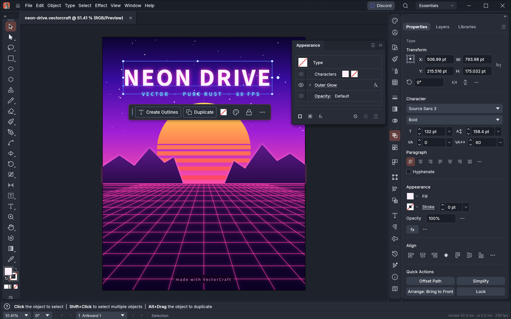
  <br><sub><b>Neon Drive</b>: a Pathfinder-cut sun, live Outer Glow on the type and grid, and clipping masks · <code>examples/neon-drive.pathsmith</code></sub>
</p>

> [!NOTE]
> **Smith Suite is a community of artists from all walks of life.** Digital, generative, music,
> games &mdash; if you make things, you're one of us. **[Come say hi on Discord](https://github.com/mahmudurrahman420/pathsmith/discussions).**

<p align="center">
  <a href="#a-look-around">A look around</a> ·
  <a href="#made-in-pathsmith">Made in Pathsmith</a> ·
  <a href="#why-pathsmith">Why Pathsmith</a> ·
  <a href="#quick-start">Quick start</a> ·
  <a href="#status">Status</a> ·
  <a href="#downloads">Downloads</a> ·
  <a href="#the-crafting-apps">The Crafting Apps</a> ·
  <a href="#license-and-credits">License</a>
</p>

## A look around

<table>
<tr>
<td width="50%" valign="top">
  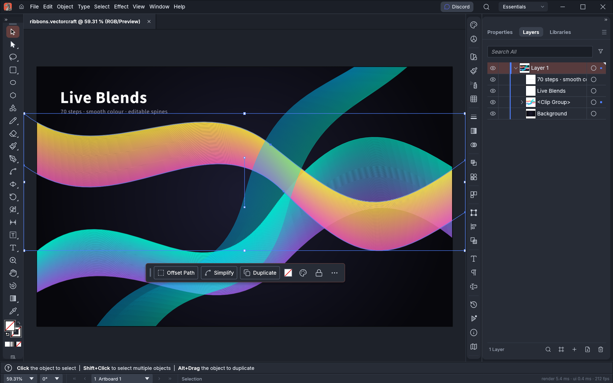
  <p align="center"><sub><b>Live Blends and Layers</b>: editable key paths, smooth colour, every object a row</sub></p>
</td>
<td width="50%" valign="top">
  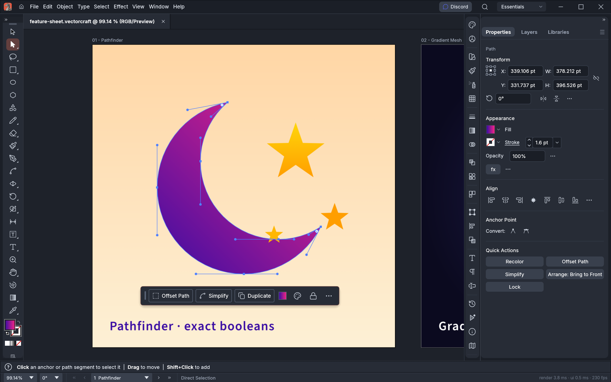
  <p align="center"><sub><b>Pen and Direct Selection</b>: real Bézier anchors and handles, plus a contextual task bar</sub></p>
</td>
</tr>
<tr>
<td width="50%" valign="top">
  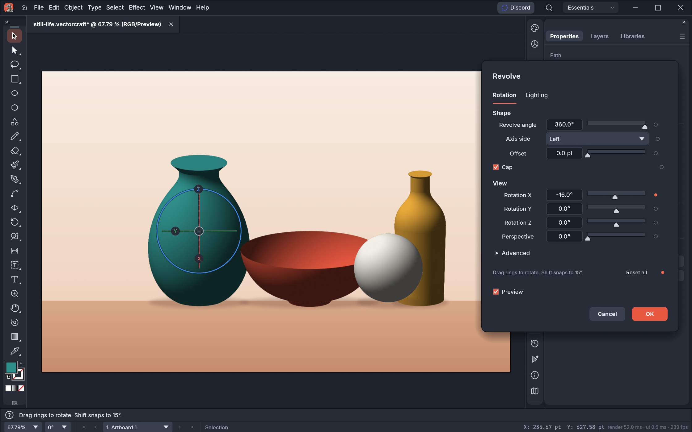
  <p align="center"><sub><b>3D Revolve</b>: smooth vector shading, caps and a rotation gizmo · <code>examples/still-life.pathsmith</code></sub></p>
</td>
<td width="50%" valign="top">
  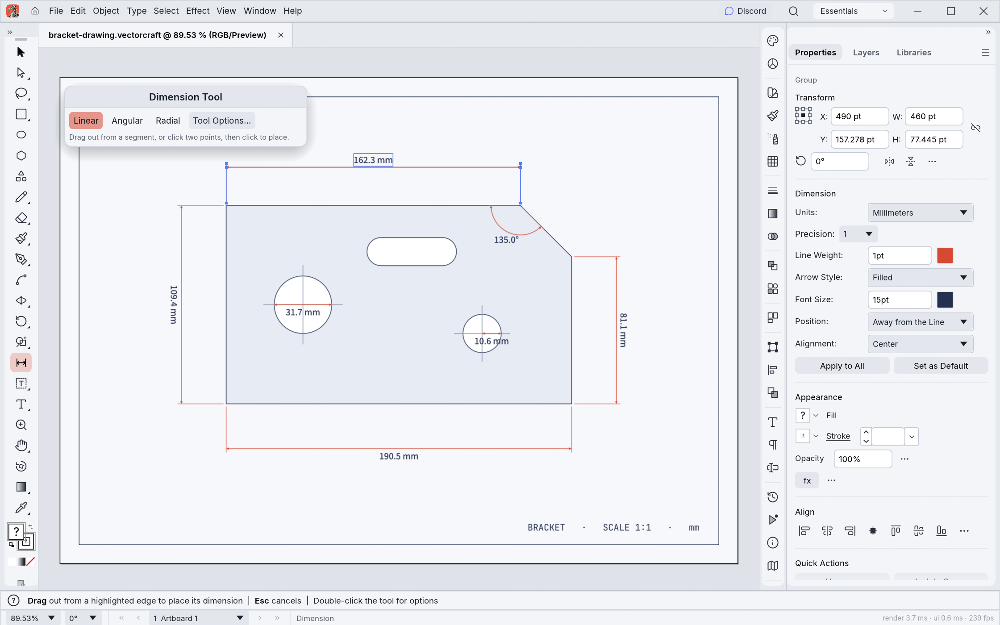
  <p align="center"><sub><b>Dimension tool</b>: lengths, angles and radii that follow the art they measure · <code>examples/bracket-drawing.pathsmith</code></sub></p>
</td>
</tr>
<tr>
<td width="50%" valign="top">
  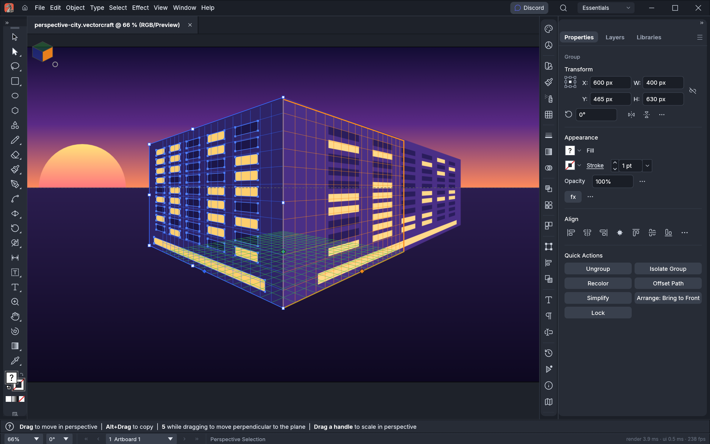
  <p align="center"><sub><b>Perspective Grid</b>: art attached to its planes stays editable in perspective · <code>examples/perspective-city.pathsmith</code></sub></p>
</td>
<td width="50%" valign="top">
  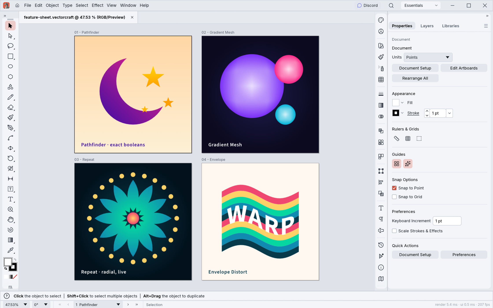
  <p align="center"><sub><b>Multiple artboards, light theme</b>: Pathfinder · Gradient Mesh · live radial Repeat · Envelope Distort · <code>examples/feature-sheet.pathsmith</code></sub></p>
</td>
</tr>
</table>

## Made in Pathsmith

Every piece below was built entirely through Pathsmith's command API, the same one the MCP server
exposes to agents, and exported by Pathsmith's own renderer. The source files are in
[`examples/`](examples).

<table>
<tr>
<td width="50%" valign="top">
  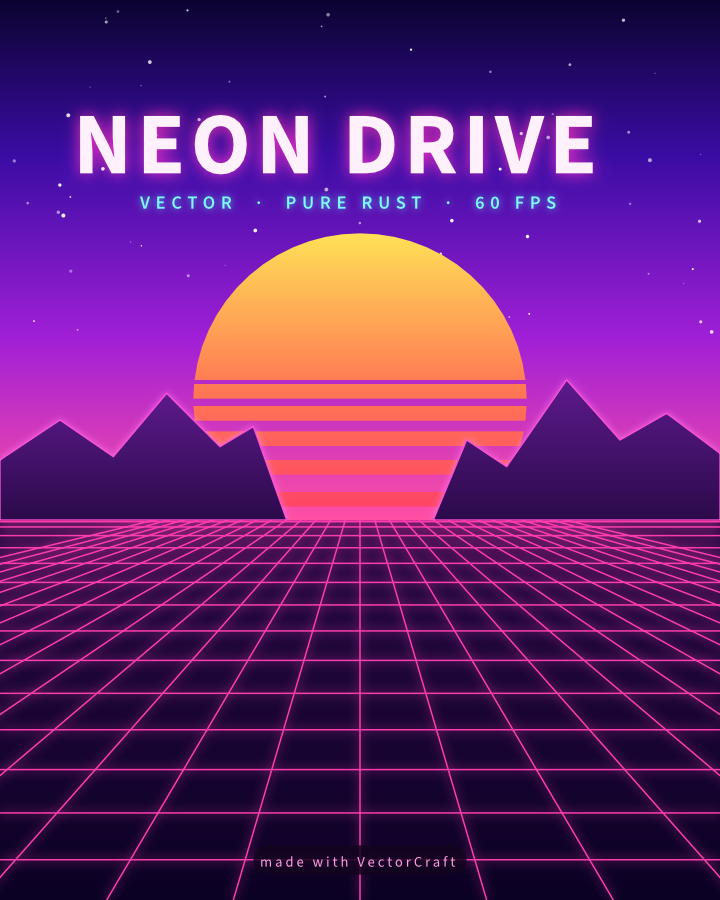
  <p align="center"><sub><b>Neon Drive</b>: synthwave poster with glowing type and grid</sub></p>
</td>
<td width="50%" valign="top">
  
  <p align="center"><sub><b>Dusk</b>: gradient sky, glowing sun, layered mountains</sub></p>
</td>
</tr>
<tr>
<td colspan="2" valign="top">
  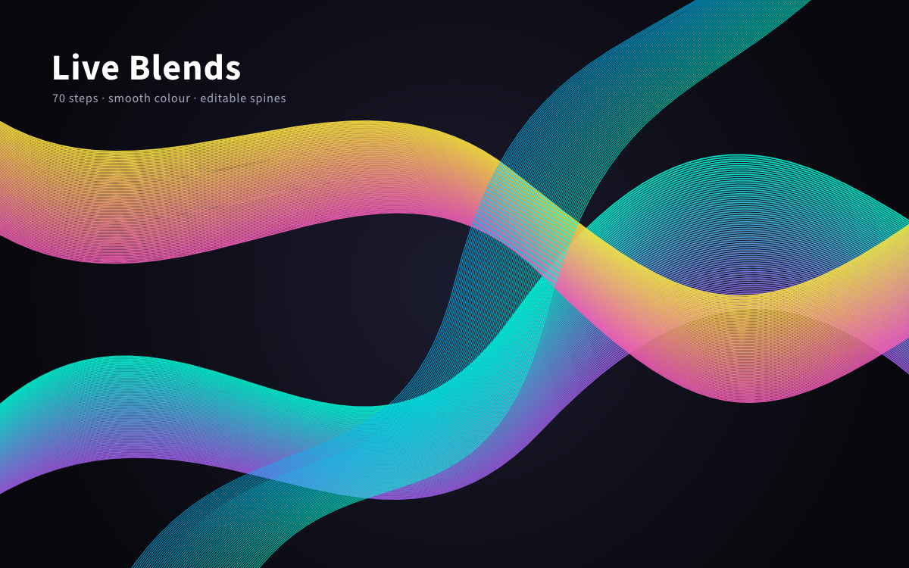
  <p align="center"><sub><b>Live Blends</b>: 70 steps, smooth colour, editable spines</sub></p>
</td>
</tr>
<tr>
<td colspan="2" valign="top">
  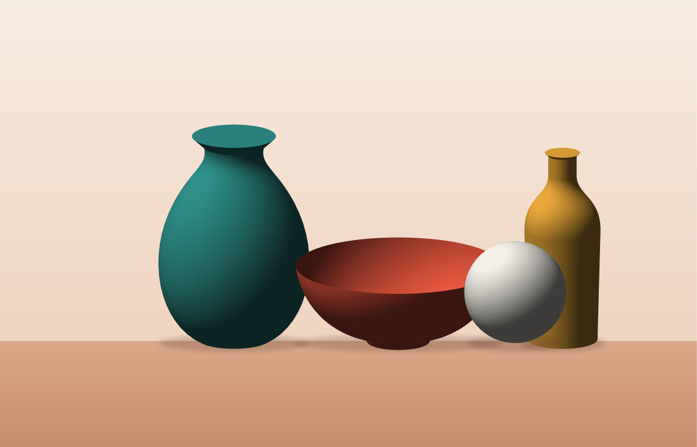
  <p align="center"><sub><b>Still Life</b>: four revolved profiles with smooth vector shading</sub></p>
</td>
</tr>
<tr>
<td width="50%" valign="top">
  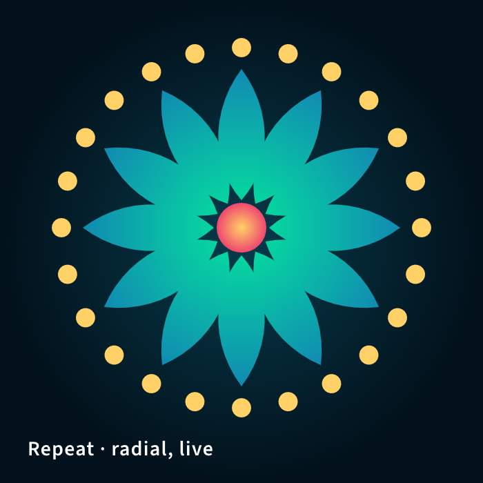
  <p align="center"><sub><b>Radial Repeat</b>: a live mandala</sub></p>
</td>
<td width="50%" valign="top">
  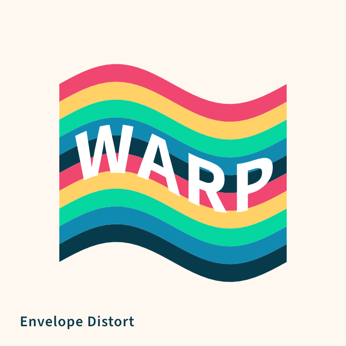
  <p align="center"><sub><b>Envelope Distort</b>: striped type warped into a flag</sub></p>
</td>
</tr>
<tr>
<td width="50%" valign="top">
  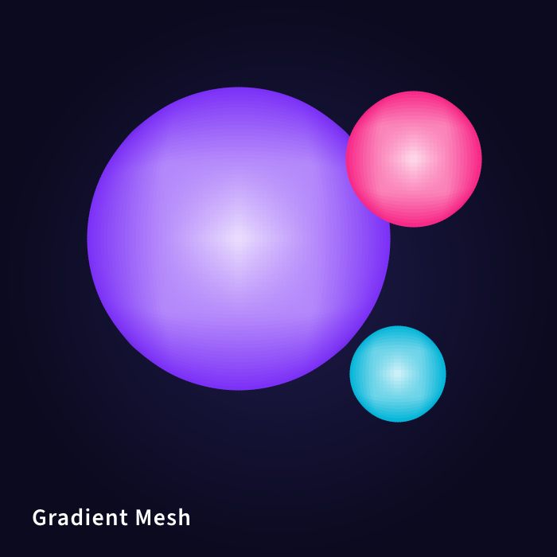
  <p align="center"><sub><b>Gradient Mesh</b>: shaded spheres</sub></p>
</td>
<td width="50%" valign="top">
  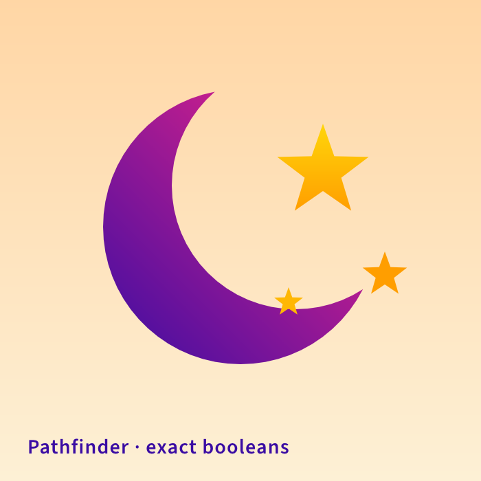
  <p align="center"><sub><b>Pathfinder</b>: a crescent and stars from exact booleans</sub></p>
</td>
</tr>
</table>

## Why Pathsmith

- **Familiar.** A familiar layout, tools, menus, panels and shortcuts: the Pen, Direct Selection,
  Pathfinder, Smart Guides, Appearance, Swatches, Layers and more. You already know how to use it.
- **Fast.** Multithreaded SIMD rendering off the UI thread. 20,000 shapes render in about 27 ms at
  full retina resolution while the interface stays at 120 fps.
- **Robust.** Exact curve booleans (no "cannot perform operation"), unlimited undo via structural
  sharing, and property-tested file round trips.
- **Open.** A documented native format (`.pathsmith`, JSON), first-class SVG, PDF (and
  PDF-compatible `.ai`) import and export, PNG/JPEG/WebP export, Export for Screens, and SVGZ,
  templates, GIF, TIFF and BMP on open.
- **Agent-native.** Every menu item, tool gesture, panel and dialog can be driven over a JSON
  control channel and an **MCP server**, so Claude and other agents can draw, edit and export the
  way a person does.
- **Everywhere.** One codebase for the desktop apps and the same UI in the browser.

## Quick start

For posters and sewing patterns, see [Print a large poster across multiple pages](docs/print-tiling.md).

```sh
git clone https://github.com/mahmudurrahman420/pathsmith
cd pathsmith

cargo run --release -p pathsmith                          # desktop app
cargo run --release -p pathsmith -- examples/dusk-poster.pathsmith
cargo run --release -p pathsmith -- --control 7979        # + JSON control channel
cargo run --release -p pathsmith-cli -- mcp               # MCP server (stdio)
cargo run --release -p pathsmith-cli -- run --in examples/ribbons.pathsmith --export out.pdf   # headless batch
cargo run --release -p pathsmith-cli -- bench examples/neon-drive.pathsmith                   # render timing
cargo xtask bundle                                        # dist/Pathsmith.app (macOS)
cd apps/pathsmith-web && trunk build --release            # web build → dist/web
cargo xtask ci                                            # fmt, clippy, tests, layering, wasm, vendor names
```

For text and custom letter shapes, see [Typography and Custom Lettering](docs/typography-lettering.md).

Japanese fonts come from [storytold/craft-fonts](https://github.com/storytold/craft-fonts), an optional
build input (releases always use it): `CRAFT_FONTS_DIR="$PWD/../craft-fonts" cargo run --release -p pathsmith` (an absolute path).
Without it, Japanese text uses the installed system fonts. See [`docs/development.md`](docs/development.md#fonts-craft-fonts-optional-build-input).

On machines with two graphics processors, Pathsmith renders on the power-saving (integrated) one by default on
Windows and macOS, and on the one the desktop runs on under Linux. To choose, use **Preferences › Performance ›
Graphics Processor** and restart. If a graphics processor can't show the window, Pathsmith starts again on the
next one. To pick one when starting the app, set `WGPU_POWER_PREF=high` (or `low`), or `WGPU_ADAPTER_NAME` to part of
its name, such as `WGPU_ADAPTER_NAME=nvidia` (see [`docs/development.md`](docs/development.md#desktop-graphics-processor)).

On native Wayland, winit 0.30 does not deliver dropped files. To open an SVG, use File › Open;
to place artwork in the current document, copy and paste the file in a file manager. For file
drag-and-drop, set **Preferences › Performance › Linux Display Server** to **X11 (XWayland)** and restart, or start
the app with `WAYLAND_DISPLAY= pathsmith`: the window then opens through XWayland, where drops work
(see [`docs/development.md`](docs/development.md#linux-wayland-and-x11)).

On Linux with Wayland, under KDE Plasma 6.3 or later and under GNOME, Pathsmith can't get a drawing tablet's pen
input on native Wayland yet (#491, #2028). When a pen is attached as Pathsmith starts, the window opens through
XWayland, where the pen works as a mouse and the app reads its pressure (#4967; `PATHSMITH_NATIVE_WAYLAND=1` keeps
Wayland). For a pen attached later, set the same preference to **X11 (XWayland)** and restart, or start the app with
`WAYLAND_DISPLAY= pathsmith` (see [`docs/development.md`](docs/development.md#linux-wayland-and-x11)).

### Use it from Claude Code and other agents

Register the MCP server with Claude Code:

```sh
claude mcp add pathsmith -- /path/to/pathsmith-cli mcp
```

To keep an agent to one project's files, give it folders to read and write (the same flags as Pixelsmith):

```sh
claude mcp add pathsmith -- /path/to/pathsmith-cli mcp --automation-read-root /work/project --automation-write-root /work/project
```

The details are in [`docs/mcp.md`](docs/mcp.md) and [`docs/control-protocol.md`](docs/control-protocol.md).

## Status

Pathsmith is under active development. [**ROADMAP.md**](ROADMAP.md) has the stage, the numbers by dimension
and what's next; [`docs/target-app-parity.md`](docs/target-app-parity.md) the full parity assessment and
[`docs/gaps.md`](docs/gaps.md) the ranked list of what's missing.

**Where we are (2026-10-10): alpha.** About 88% of core menu items, tools, effects and formats exist
(92.5% of menu items do something), feature depth is ~75%, and we estimate ~65% ready for real work for a mainstream illustrator (~62% across all tracked features): everyday
vector illustration is close to usable: drawing and path tools,
Pathfinder and Shape Builder, paint, gradients, appearance and transparency, type with styles, threading and Hebrew/Arabic bidirectional layout, and
files (SVG, PDF and PDF-compatible `.ai` with PDF/X, legacy version 7 `.ai` keeping layers, groups and type, EPS, DXF, EMF/WMF, raster formats, PSD out and PSD/PSB in as their merged image, Print, Package).
Affinity documents (`.af` from Affinity 3, `.afdesign`, `.afpub` and, by their content, `.afphoto` from Affinity 1 and 2) open
and place natively: layers, groups, artboards and pages, curves and shapes, fills, gradients and strokes, clipping
and masks, text with each paragraph's indents, spacing and leading, tables (as text frames and lines), master
pages, shadows, glows, outlines and overlays, embedded Affinity documents and images, with what didn't come in
(adjustments, blurs, bevels, brushes…) listed in the import warning; a file whose native data can't be read opens as its embedded preview, saying why. Pathsmith
doesn't write Affinity files. Current `.af` validation includes 33 pinned files, native save/reload
and every-board SVG/PDF/PSD export, with fixes for Affinity 3 artboards, source-backed JPEGs and text runs.
[Scope and limits](crates/affinity/README.md); [source audit and remaining gaps](docs/affinity-validation.md).
The interface
speaks English, German, Japanese, Korean, Vietnamese, Traditional and Simplified Chinese, Spanish, French, Hungarian, Italian, Polish, Brazilian Portuguese, Russian, Swedish, Ukrainian, Finnish, Bulgarian, Greek, Czech, Georgian and Catalan;
[localization-parity.md](docs/localization-parity.md) has the details.
The scores are self-assessed from our code against public documentation;
[target-app-parity.md](docs/target-app-parity.md#how-this-was-measured-2026-10-10) explains how far to trust them.

**What's missing:**
- reliable exchange of .ai files (layer structure in real files; proprietary editing data isn't written);
- an interaction-fidelity pass covering every tool's modifiers and small behaviours;
- 3D and Materials beyond the initial live Revolve (Extrude & Bevel, Inflate, Rotate, materials);
- filter thumbnails and a preview area inside the Effect Gallery (the gallery itself and all 57 Photoshop-style raster filters, approximated, are in);
- CJK composition for vertical type (vertical type itself has initial support, with a Japanese interface);
- scripting, and the rest of Variables (image and graph kinds, dataset import);
- generative AI features.

**Where we're going:** next is the interaction-fidelity pass, `.ai` files from real users and start-up stability,
alongside the raster-effects package; then type, recent additions and 3D. The ranked list is in
[`docs/gaps.md`](docs/gaps.md).

**Workspace:** `crates/{geom, color, doc, pathops, text, effects, three-d, trace, brush, render, svg, pdf, eps, cad, metafile, format, tools, engine, ui-egui, mcp, testkit}`
and `apps/{pathsmith, pathsmith-cli, pathsmith-web}`. The egui frontend is its own crate, so
the UI can be swapped without touching the engine.

Agent and contributor rules (clean-room, the asset policy, no panics in shipped code, quality gates) are in
[`AGENTS.md`](AGENTS.md); [`docs/development.md`](docs/development.md#robustness-pathsmith-never-crashes)
explains how Pathsmith avoids crashing, and [`docs/releasing.md`](docs/releasing.md) how releases are built,
signed and published. Every bundled asset is listed with its licence in [`ASSETS.md`](ASSETS.md).

## Downloads

**New to Pathsmith?** Download it from the [Pathsmith page on github.com/mahmudurrahman420](https://github.com/mahmudurrahman420/pathsmith). That's the easiest way to install it.

**Want a specific build or format?** On GitHub, the [latest release](https://github.com/mahmudurrahman420/pathsmith/releases/latest) has every build listed below, and [all releases](https://github.com/mahmudurrahman420/pathsmith/releases) has earlier versions and their notes. `<ver>` in the file names is the version number, and `SHA256SUMS.txt` lists a checksum for every file.

### Windows

| Build | Installer | Portable |
|---|---|---|
| x64 (64-bit Intel/AMD) | `pathsmith-<ver>-windows-x64.msi` | `pathsmith-<ver>-windows-x64-portable.zip` |
| arm64 (Snapdragon and other ARM PCs) | `pathsmith-<ver>-windows-arm64.msi` | `pathsmith-<ver>-windows-arm64-portable.zip` |
| x86 (32-bit) | `pathsmith-<ver>-windows-x86.msi` | `pathsmith-<ver>-windows-x86-portable.zip` |

Installers and executables are code-signed.

### macOS

| Build | File | Notes |
|---|---|---|
| App, universal (Apple silicon + Intel) | `pathsmith-<ver>-macos-universal.dmg` | Signed and notarized |
| Command-line tool, universal | `pathsmith-cli-<ver>-macos-universal.zip` | Signed and notarized |

### Linux

| Format | x86_64 | aarch64 (ARM64) | Notes |
|---|---|---|---|
| AppImage | `pathsmith-<ver>-linux-x86_64.AppImage` | `pathsmith-<ver>-linux-aarch64.AppImage` | Runs anywhere; updates itself with [AppImageUpdate](https://github.com/AppImageCommunity/AppImageUpdate) (`.zsync` files) |
| Flatpak | `pathsmith-<ver>-linux-x86_64.flatpak` | `pathsmith-<ver>-linux-aarch64.flatpak` | Sandboxed; `flatpak install --user <file>` |
| Debian/Ubuntu | `pathsmith-<ver>-linux-x86_64.deb` | `pathsmith-<ver>-linux-aarch64.deb` | |
| Fedora/RHEL/openSUSE | `pathsmith-<ver>-linux-x86_64.rpm` | `pathsmith-<ver>-linux-aarch64.rpm` | |
| Tarball | `pathsmith-<ver>-linux-x86_64.tar.gz` | `pathsmith-<ver>-linux-aarch64.tar.gz` | Unpack anywhere |

### FreeBSD

| Build | File |
|---|---|
| x86_64 | `pathsmith-<ver>-freebsd-x86_64.tar.gz` |

### Web (WebAssembly)

| Build | File | Notes |
|---|---|---|
| Static site | `pathsmith-web-<ver>.zip` | Runs in a modern browser; host it on any static server |

## The Crafting Apps

Pathsmith is one of the **Crafting Apps**: free, open-source creative tools from the
[Smith Suite](https://github.com/mahmudurrahman420/) team, each written from scratch in Rust and each able to
stand on its own.

| | App | What it's for | Code | Learn more |
|:-:|---|---|---|---|
|  | **Pixelsmith** | Image editing: layers, masks, type and real PSD files | [GitHub](https://github.com/mahmudurrahman420/pixelsmith) | [Website](https://github.com/mahmudurrahman420/pixelsmith) |
|  | **Pathsmith** | Vector illustration | [GitHub](https://github.com/mahmudurrahman420/pathsmith) | [Website](https://github.com/mahmudurrahman420/pathsmith) |
|  | **Framesmith** | Video editing, color and sound | [GitHub](https://github.com/mahmudurrahman420/framesmith) | [Website](https://github.com/mahmudurrahman420/framesmith) |
|  | **Rawsmith** | Photo library and raw development | [GitHub](https://github.com/mahmudurrahman420/rawsmith) | [Website](https://github.com/mahmudurrahman420/rawsmith) |
|  | **Pagesmith** | Reading, organizing and protecting PDFs | [GitHub](https://github.com/mahmudurrahman420/pagesmith) | [Website](https://github.com/mahmudurrahman420/pagesmith) |
|  | **Motionsmith** | Motion graphics and visual effects | [GitHub](https://github.com/mahmudurrahman420/motionsmith) | [Website](https://github.com/mahmudurrahman420/motionsmith) |
|  | **Layoutsmith** | Page layout and publishing | [GitHub](https://github.com/mahmudurrahman420/layoutsmith) | [Website](https://github.com/mahmudurrahman420/layoutsmith) |
|  | **Mocksmith** | Interface design and prototyping | [GitHub](https://github.com/mahmudurrahman420/mocksmith) | [Website](https://github.com/mahmudurrahman420/mocksmith) |
|  | **Wordsmith** | Word processing and documents | [GitHub](https://github.com/mahmudurrahman420/wordsmith) | [Website](https://github.com/mahmudurrahman420/wordsmith) |
|  | **Soundsmith** | Audio recording and editing | [GitHub](https://github.com/mahmudurrahman420/soundsmith) | [Website](https://github.com/mahmudurrahman420/soundsmith) |
|  | **Slidesmith** | Presentations and slide decks | [GitHub](https://github.com/mahmudurrahman420/slidesmith) | [Website](https://github.com/mahmudurrahman420/slidesmith) |
|  | **CADsmith** | Computer-aided design | [GitHub](https://github.com/mahmudurrahman420/cadsmith) | [Website](https://github.com/mahmudurrahman420/cadsmith) |
|  | **Cellsmith** | Spreadsheets and data | [GitHub](https://github.com/mahmudurrahman420/cellsmith) | [Website](https://github.com/mahmudurrahman420/cellsmith) |
|  | **Texsmith** | 3D texture painting | [GitHub](https://github.com/mahmudurrahman420/texsmith) | [Website](https://github.com/mahmudurrahman420/texsmith) |
|  | **Anysmith** | See how any software works, then build your own | [GitHub](https://github.com/mahmudurrahman420/anysmith) | [Website](https://github.com/mahmudurrahman420/anysmith) |
|  | **Solidsmith** | Parametric 3D CAD by Tangency Labs (community app) | [GitHub](https://github.com/mahmudurrahman420/solidsmith) | |

And [**Smith Suite**](https://github.com/mahmudurrahman420/) itself, our AI image and video studio for artists who want real control.

<br>

<p align="center">
  <a href="https://github.com/mahmudurrahman420/pathsmith/discussions"></a>
</p>

<h3 align="center">Come make things with us</h3>

<p align="center">
  Our Discord is where artists of every kind hang out: people who paint, shoot, draw, cut film,
  set type, and people still figuring out what they like to make. Share what you're working on,
  ask for help, tell us what's broken, or tell us what you wish these tools could do.
  Whatever your medium and however long you've been at it, you're welcome here.
</p>

<p align="center">
  <a href="https://github.com/mahmudurrahman420/pathsmith/discussions"><b>https://github.com/mahmudurrahman420/pathsmith/discussions</b></a> ·
  <a href="https://github.com/mahmudurrahman420/">github.com/mahmudurrahman420</a> ·
  <a href="https://github.com/mahmudurrahman420/apps">The Crafting Apps</a> ·
  <a href="https://github.com/mahmudurrahman420/pathsmith">Pathsmith</a>
</p>

## Star history

[](https://www.star-history.com/?repos=storytold%2Fpathsmith&type=date&legend=top-left)

## License and credits

Pathsmith is dual-licensed under [MIT](LICENSE-MIT) or [Apache-2.0](LICENSE-APACHE), at your option.
Copyright (c) 2026 Shohan (mahmudurrahman420) and the Pathsmith contributors. Required notices are in [NOTICE](NOTICE).

Bundled fonts, icons, images and other assets keep their own open licenses; each one is listed
with its author, source and license in [ASSETS.md](ASSETS.md). Release builds also embed the
fonts of [craft-fonts](https://github.com/storytold/craft-fonts/blob/main/ATTRIBUTION.md) (Japanese,
Simplified Chinese and Arabic faces; SIL Open Font License 1.1).

The app icon (an engraved dragon on Pathsmith red, `#e8573f`) is the owner's original artwork; its
palette and files are in [`assets/app-icon/`](assets/app-icon/README.md).

The Smith Suite name, wordmark and anvil mark in `docs/brand/` are original work by Shohan (mahmudurrahman420), licensed under the project licence (MIT OR Apache-2.0).

<p align="center">
  <a href="https://github.com/mahmudurrahman420/"></a><br>
  <sub>Made by the <a href="https://github.com/mahmudurrahman420/">Smith Suite</a> team and community.</sub>
</p>
