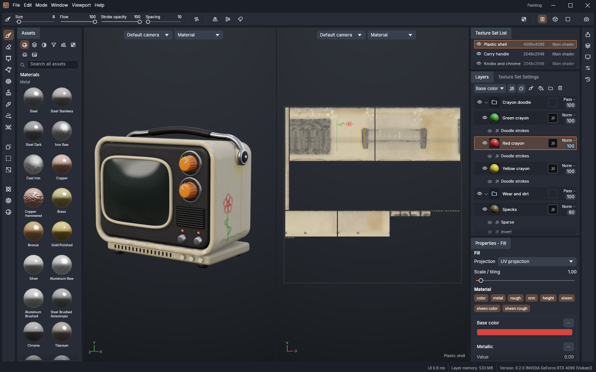
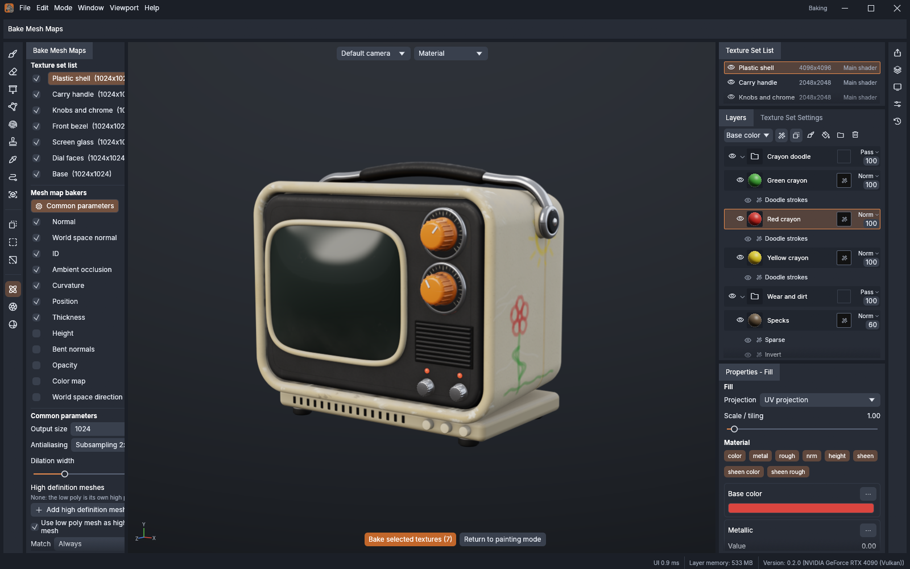
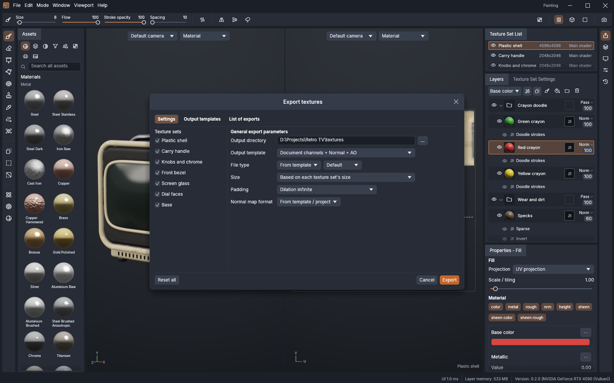
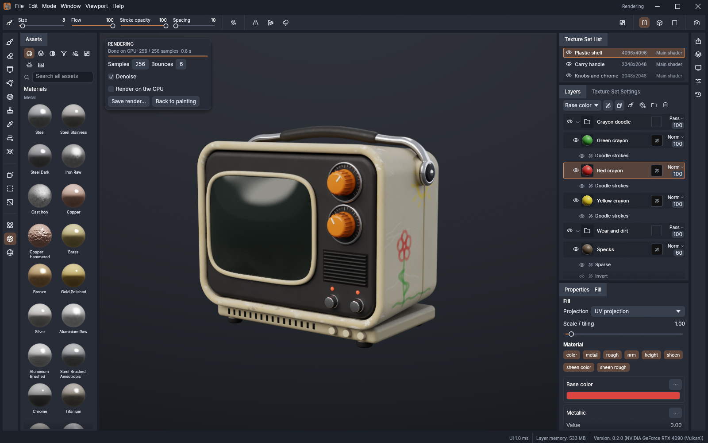
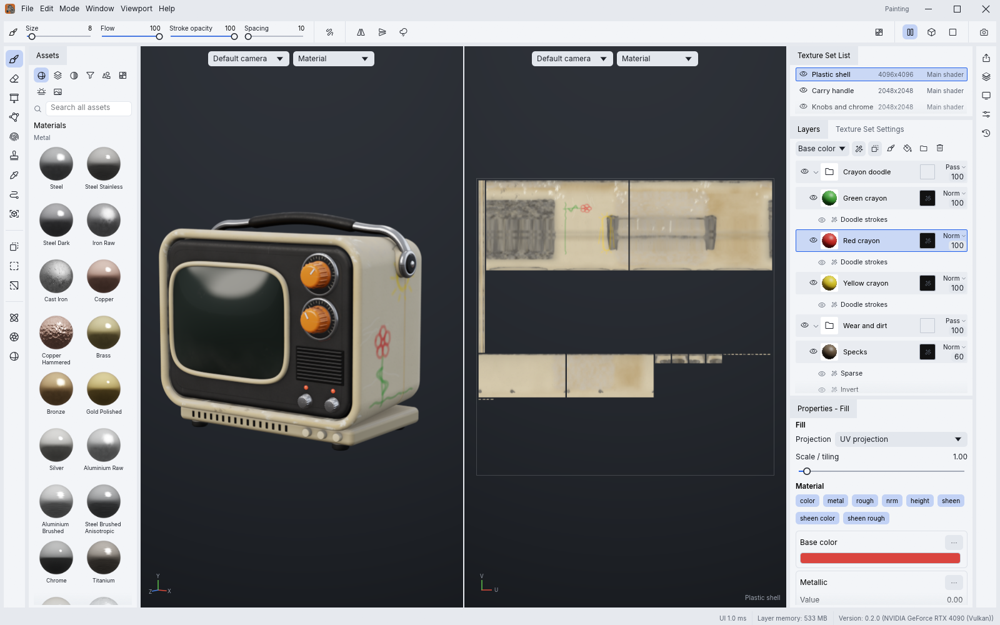
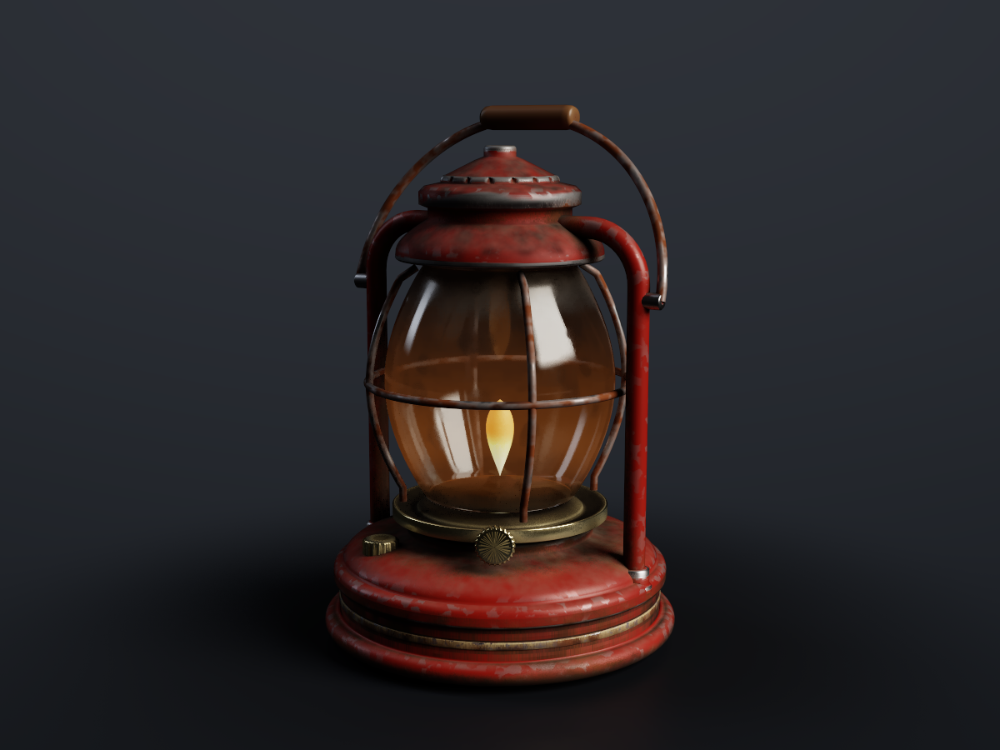
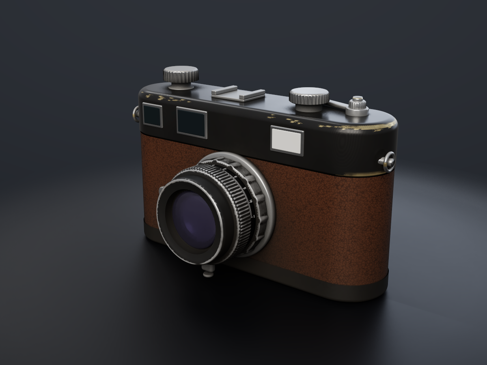
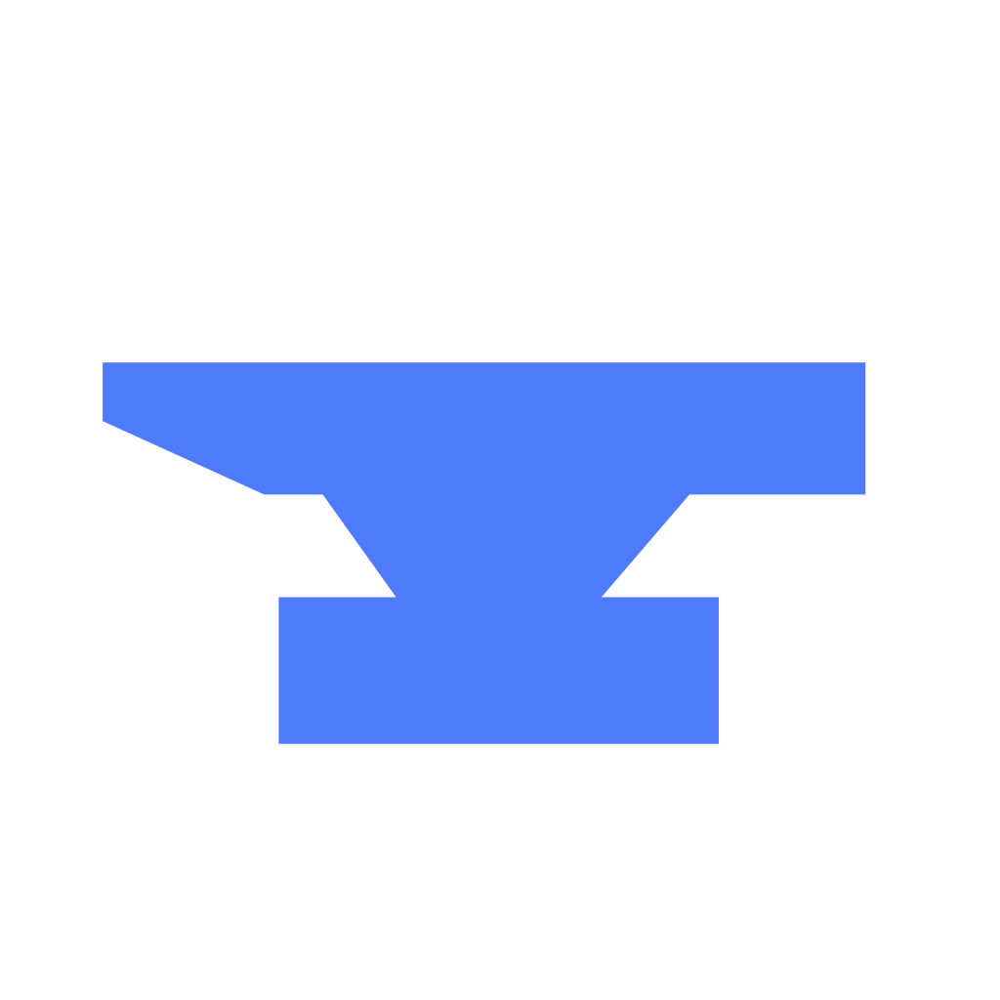

<p align="center">
  <a href="https://github.com/mahmudurrahman420/">
    <picture>
      <source media="(prefers-color-scheme: dark)" srcset="docs/brand/smithsuite-logo-white.png">
      
    </picture>
  </a>
</p>


<p align="center">
  
</p>

<h1 align="center">Texsmith</h1>


<p align="center">
  <b>3D texture painting; an open-source, modern texture painting application, built in pure Rust.</b>
</p>

<p align="center">
  A fast, open-source 3D texture painting workflow: paint PBR materials straight onto your models in
  layers with masks, bake mesh maps, drive smart materials from them and export textures for any
  engine. It runs natively on macOS, Windows, Linux and FreeBSD, and in the browser via WebAssembly.
  Built by the Smith Suite team.
</p>

<p align="center">
  
  
  
  
  
  <br>
  <a href="https://coderabbit.ai"></a>
</p>

<p align="center">
  <a href="https://github.com/mahmudurrahman420/texsmith/discussions"></a>
</p>

<p align="center">
  <a href="https://github.com/mahmudurrahman420/texsmith"><b>Texsmith on github.com/mahmudurrahman420</b></a> ·
  <a href="https://github.com/mahmudurrahman420/">Smith Suite</a> ·
  <a href="https://github.com/mahmudurrahman420/apps">All Crafting Apps</a>
</p>

<br>

<p align="center">
  
  <br><sub><b>The workspace</b>: asset shelf, 3D viewport, 2D UV view, texture sets, layer stack and properties</sub>
</p>

> [!NOTE]
> **Smith Suite is a community of artists from all walks of life.** Painters, sculptors, game
> artists, photographers, filmmakers, illustrators, designers, hobbyists, and people who picked up
> a stylus last week. If you make things, you belong here. **[Come say hi on Discord](https://github.com/mahmudurrahman420/texsmith/discussions).**

<p align="center">
  <a href="#a-look-around">A look around</a> ·
  <a href="#made-in-texsmith">Made in Texsmith</a> ·
  <a href="#why-texsmith">Why Texsmith</a> ·
  <a href="#quick-start">Quick start</a> ·
  <a href="#status">Status</a> ·
  <a href="#downloads">Downloads</a> ·
  <a href="#the-crafting-apps">The Crafting Apps</a> ·
  <a href="#license-and-credits">License</a>
</p>

## A look around

<table>
<tr>
<td width="50%" valign="top">
  
  <p align="center"><sub><b>Bake mesh maps</b>: ambient occlusion, curvature, thickness and more, ray traced on the GPU</sub></p>
</td>
<td width="50%" valign="top">
  
  <p align="center"><sub><b>Export textures</b>: presets for common engines, or your own output templates with channel packing</sub></p>
</td>
</tr>
<tr>
<td width="50%" valign="top">
  
  <p align="center"><sub><b>Rendering mode</b> (F10): your textures path traced on the GPU, with a denoiser</sub></p>
</td>
<td width="50%" valign="top">
  
  <p align="center"><sub><b>Light theme</b>: four brightness levels and seven accent colours</sub></p>
</td>
</tr>
</table>

## Made in Texsmith

Two original props, modelled procedurally by contributors, textured layer by layer with Texsmith's
own materials, masks and mesh-map generators (no textures or models from anywhere else) and path
traced on the GPU by `texsmith-cli render`.

<table>
<tr>
<td width="50%" valign="top">
  
  <p align="center"><sub><b>Storm lantern</b>: chipped enamel, rust, soot and a lit flame over eight texture sets</sub></p>
</td>
<td width="50%" valign="top">
  
  <p align="center"><sub><b>Rangefinder camera</b>: black paint brassing, leatherette, chrome and coated glass</sub></p>
</td>
</tr>
</table>

## Why Texsmith

- **Familiar.** The layout, tools, menus, panels and shortcuts texture artists already know: texture
  sets, a layer stack with per-channel blending, masks and generators, smart materials, the tool
  shelf, the 3D and 2D views. You already know how to use it.
- **Fast.** A tiled, copy-on-write texel engine on every CPU core and a wgpu viewport (Vulkan,
  Metal, DX12, WebGPU). Mesh maps bake on the GPU about 12× faster than on the CPU, Rendering mode
  path traces about 25× faster, and 8K texture sets stay responsive while you paint.
- **Seamless.** Brush stamps live on the 3D surface, so strokes flow across UV seams, and the
  camera's visibility keeps paint off the back of your model.
- **Robust.** No panics in shipped code, every command tested with hostile input, unlimited undo
  from copy-on-write snapshots, and lossless `.tcraft` projects.
- **Open.** glTF/GLB, FBX, COLLADA, USD, Alembic, OBJ, PLY and STL in; PNG, JPEG, TGA, TIFF, BMP,
  WEBP, EXR and HDR textures out at 8, 16 or 32 bits, with UDIM tiles; textured OBJ, GLB and USD
  mesh export. Every material, environment, brush alpha and built-in mesh is procedural.
- **Works with MaterialCraft.** Node-based materials from
  [MaterialCraft](https://github.com/storytold/materialcraft) (`.mcmat`, sent straight to the
  shelf) paint and fill like any material, and their graph inputs stay sliders, colors and
  presets here: each change re-cooks the material at the texture set's resolution, with this
  mesh's baked maps feeding the graph.
- **Agent-native.** Every menu item and tool is a command you can drive from the CLI, a JSON
  control channel or an **MCP server**, so Claude and other agents can paint, bake and export the
  way a person does.
- **Everywhere.** One codebase for the desktop apps and the same UI in the browser.

The full list of what's in it is in [`docs/features.md`](docs/features.md).

## Quick start

```sh
git clone https://github.com/mahmudurrahman420/texsmith
cd texsmith

cargo run --release -p texsmith                          # desktop app (opens a sample project)
cargo run --release -p texsmith -- model.glb             # a new project from a mesh
cargo run --release -p texsmith -- --control 7878        # + JSON control channel
cargo run --release -p texsmith-cli -- mcp               # MCP server (stdio)
cargo run --release -p texsmith-cli -- new builtin:crate crate.tcraft --sample
cargo run --release -p texsmith-cli -- render crate.tcraft crate.png --samples 256   # path traced
cargo run --release -p texsmith-cli -- export crate.tcraft textures                 # headless export
cd apps/texsmith-web && trunk serve                      # web build
cargo xtask ci                                               # fmt, clippy, tests, layering, wasm
```

You need Rust 1.95 or newer. The app opens with a baked sample project and a start window (new project, open, recent projects); **File ▸ New project** starts
from a built-in mesh, a project template or your own mesh file (UVs are generated if it has none).

Japanese, Chinese, Korean and Arabic interface text uses the fonts of
[storytold/craft-fonts](https://github.com/storytold/craft-fonts) where it has them, an optional
build input (releases always use it): `CRAFT_FONTS_DIR="$PWD/../craft-fonts" cargo run --release -p texsmith`
(an absolute path). Without it, the desktop app uses the installed system fonts.

If the app cannot start (no usable GPU, say) or has to close, it says why in a message box and
appends the details to `errors.log` beside its settings (`%APPDATA%\Texsmith\data` on Windows,
`~/Library/Application Support/Texsmith` on macOS, `~/.local/share/texsmith` on Linux).
On a machine with several GPUs, `--gpu <part of the name>` or `--power-pref high` picks one.

### Use it from Claude Code and other agents

Register the MCP server with Claude Code, giving it the folders it may read and write:

```sh
claude mcp add texsmith -- /path/to/texsmith-cli mcp --read-root /work/project --write-root /work/project
```

To drive the running app instead, start it with `--control 7878` and bridge to it:

```sh
claude mcp add texsmith-app -- /path/to/texsmith-cli mcp --bridge 7878
```

The details are in [`docs/control-protocol.md`](docs/control-protocol.md).

## Status

Texsmith is under active development. [**ROADMAP.md**](ROADMAP.md) has the parity estimate by
area, the remaining work and what's next.

**Where we are (2026-11-01):** we estimate about 93% of a texture artist's daily workflow works end
to end, weighted by how much of the day each area carries: importing meshes, texture sets and UDIM
tiles, the layer stack with masks, effects and smart materials, every painting tool, baking, the PBR
viewport and Rendering mode, export presets and templates, and the full menu set. The interface
speaks English, French, German, Spanish, Portuguese, Italian, Japanese, Chinese, Korean and Arabic;
[localization-parity.md](docs/localization-parity.md) has the details. The scores are self-assessed
from our code against public documentation.

**What's missing:**
- hardware ray tracing in Rendering mode;
- pen tilt, and pen pressure on Linux, macOS and desktop browsers (the windowing layer doesn't
  report them yet);
- Alembic files in the older HDF5 container, and Alembic animation (the first sample is read);
- a native-speaker review of the translations;
- the first signed release on every platform.

**Where we're going:** the first release, v0.1.0, on every platform; then the remaining rendering
and file format gaps. The ranked list is in [`ROADMAP.md`](ROADMAP.md).

**Workspace:** `crates/{core, texel, geom, compose, bake, paint, formats, engine, render, automation, ui-egui}`
and `apps/{texsmith, texsmith-cli, texsmith-web}`. The egui frontend is its own crate, so
the UI can be swapped without touching the engine; [`docs/architecture.md`](docs/architecture.md)
explains how it fits together.

Agent and contributor rules (clean room, the asset policy, no panics in shipped code, quality gates)
are in [`AGENTS.md`](AGENTS.md), and [`docs/releasing.md`](docs/releasing.md) explains how releases
are built, signed and published. Every bundled asset is listed with its licence in
[`ATTRIBUTION.md`](ATTRIBUTION.md).

## Downloads

**New to Texsmith?** Download it from the [Texsmith page on github.com/mahmudurrahman420](https://github.com/mahmudurrahman420/texsmith). That's the easiest way to install it.

**Want a specific build or format?** On GitHub, the [latest release](https://github.com/mahmudurrahman420/texsmith/releases/latest) has every build listed below, and [all releases](https://github.com/mahmudurrahman420/texsmith/releases) has earlier versions and their notes. `<ver>` in the file names is the version number, and `SHA256SUMS.txt` lists a checksum for every file.

### Windows

| Build | Installer | Portable |
|---|---|---|
| x64 (64-bit Intel/AMD) | `texsmith-<ver>-windows-x64.msi` | `texsmith-<ver>-windows-x64-portable.zip` |
| arm64 (Snapdragon and other ARM PCs) | `texsmith-<ver>-windows-arm64.msi` | `texsmith-<ver>-windows-arm64-portable.zip` |
| x86 (32-bit) | `texsmith-<ver>-windows-x86.msi` | `texsmith-<ver>-windows-x86-portable.zip` |

### macOS

| Build | File | Notes |
|---|---|---|
| App, universal (Apple silicon + Intel) | `texsmith-<ver>-macos-universal.dmg` | Signed and notarized |
| Command-line tool, universal | `texsmith-cli-<ver>-macos-universal.zip` | Signed and notarized |

### Linux

| Format | x86_64 | aarch64 (ARM64) | Notes |
|---|---|---|---|
| AppImage | `texsmith-<ver>-linux-x86_64.AppImage` | `texsmith-<ver>-linux-aarch64.AppImage` | Runs anywhere; updates itself with [AppImageUpdate](https://github.com/AppImageCommunity/AppImageUpdate) (`.zsync` files) |
| Flatpak | `texsmith-<ver>-linux-x86_64.flatpak` | `texsmith-<ver>-linux-aarch64.flatpak` | Sandboxed; `flatpak install --user <file>` |
| Debian/Ubuntu | `texsmith-<ver>-linux-x86_64.deb` | `texsmith-<ver>-linux-aarch64.deb` | |
| Fedora/RHEL/openSUSE | `texsmith-<ver>-linux-x86_64.rpm` | `texsmith-<ver>-linux-aarch64.rpm` | |
| Tarball | `texsmith-<ver>-linux-x86_64.tar.gz` | `texsmith-<ver>-linux-aarch64.tar.gz` | Unpack anywhere |

### FreeBSD

| Build | File |
|---|---|
| x86_64 | `texsmith-<ver>-freebsd-x86_64.tar.gz` |

### Web (WebAssembly)

| Build | File | Notes |
|---|---|---|
| Static site | `texsmith-web-<ver>.zip` | Runs in a modern browser; host it on any static server |

## The Crafting Apps

Texsmith is one of the **Crafting Apps**: free, open-source creative tools from the
[Smith Suite](https://github.com/mahmudurrahman420/) team, each written from scratch in Rust and each able to
stand on its own.

| | App | What it's for | Code | Learn more |
|:-:|---|---|---|---|
|  | **Pixelsmith** | Image editing: layers, masks, type and real PSD files | [GitHub](https://github.com/mahmudurrahman420/pixelsmith) | [Website](https://github.com/mahmudurrahman420/pixelsmith) |
|  | **Pathsmith** | Vector illustration | [GitHub](https://github.com/mahmudurrahman420/pathsmith) | [Website](https://github.com/mahmudurrahman420/pathsmith) |
|  | **Framesmith** | Video editing, color and sound | [GitHub](https://github.com/mahmudurrahman420/framesmith) | [Website](https://github.com/mahmudurrahman420/framesmith) |
|  | **Rawsmith** | Photo library and raw development | [GitHub](https://github.com/mahmudurrahman420/rawsmith) | [Website](https://github.com/mahmudurrahman420/rawsmith) |
|  | **Pagesmith** | Reading, organizing and protecting PDFs | [GitHub](https://github.com/mahmudurrahman420/pagesmith) | [Website](https://github.com/mahmudurrahman420/pagesmith) |
|  | **Motionsmith** | Motion graphics and visual effects | [GitHub](https://github.com/mahmudurrahman420/motionsmith) | [Website](https://github.com/mahmudurrahman420/motionsmith) |
|  | **Layoutsmith** | Page layout and publishing | [GitHub](https://github.com/mahmudurrahman420/layoutsmith) | [Website](https://github.com/mahmudurrahman420/layoutsmith) |
|  | **Mocksmith** | Interface design and prototyping | [GitHub](https://github.com/mahmudurrahman420/mocksmith) | [Website](https://github.com/mahmudurrahman420/mocksmith) |
|  | **Wordsmith** | Word processing and documents | [GitHub](https://github.com/mahmudurrahman420/wordsmith) | [Website](https://github.com/mahmudurrahman420/wordsmith) |
|  | **Soundsmith** | Audio recording and editing | [GitHub](https://github.com/mahmudurrahman420/soundsmith) | [Website](https://github.com/mahmudurrahman420/soundsmith) |
|  | **Slidesmith** | Presentations and slide decks | [GitHub](https://github.com/mahmudurrahman420/slidesmith) | [Website](https://github.com/mahmudurrahman420/slidesmith) |
|  | **CADsmith** | Computer-aided design | [GitHub](https://github.com/mahmudurrahman420/cadsmith) | [Website](https://github.com/mahmudurrahman420/cadsmith) |
|  | **Cellsmith** | Spreadsheets and data | [GitHub](https://github.com/mahmudurrahman420/cellsmith) | [Website](https://github.com/mahmudurrahman420/cellsmith) |
|  | **Texsmith** | 3D texture painting | [GitHub](https://github.com/mahmudurrahman420/texsmith) | [Website](https://github.com/mahmudurrahman420/texsmith) |
|  | **Anysmith** | See how any software works, then build your own | [GitHub](https://github.com/mahmudurrahman420/anysmith) | [Website](https://github.com/mahmudurrahman420/anysmith) |
|  | **Solidsmith** | Parametric 3D CAD by Tangency Labs (community app) | [GitHub](https://github.com/mahmudurrahman420/solidsmith) | |

And [**Smith Suite**](https://github.com/mahmudurrahman420/) itself, our AI image and video studio for artists who want real control.

<br>

<p align="center">
  <a href="https://github.com/mahmudurrahman420/texsmith/discussions"></a>
</p>

<h3 align="center">Come make things with us</h3>

<p align="center">
  Our Discord is where artists of every kind hang out: people who paint, sculpt, model, shoot, draw,
  cut film, set type, and people still figuring out what they like to make. Share what you're
  working on, ask for help, tell us what's broken, or tell us what you wish these tools could do.
  Whatever your medium and however long you've been at it, you're welcome here.
</p>

<p align="center">
  <a href="https://github.com/mahmudurrahman420/texsmith/discussions"><b>https://github.com/mahmudurrahman420/texsmith/discussions</b></a> ·
  <a href="https://github.com/mahmudurrahman420/">github.com/mahmudurrahman420</a> ·
  <a href="https://github.com/mahmudurrahman420/apps">The Crafting Apps</a> ·
  <a href="https://github.com/mahmudurrahman420/texsmith">Texsmith</a>
</p>

## Star history

[](https://www.star-history.com/?repos=storytold%2Ftexsmith&type=date&legend=top-left)

## License and credits

Texsmith is dual-licensed under [MIT](LICENSE-MIT) or [Apache-2.0](LICENSE-APACHE), at your option.
Copyright (c) 2026 Shohan (mahmudurrahman420) and the Texsmith contributors. Required notices are in [NOTICE](NOTICE).

Bundled fonts, icons, images and other assets keep their own open licenses; each one is listed
with its author, source and license in [ATTRIBUTION.md](ATTRIBUTION.md). Release builds also embed
the fonts of [craft-fonts](https://github.com/storytold/craft-fonts/blob/main/ATTRIBUTION.md)
(Japanese and Simplified Chinese faces; SIL Open Font License 1.1).

Every material, environment, brush alpha and mesh shown is generated procedurally by Texsmith
itself; no third-party textures or models appear in the screenshots.

The app icon (an engraved zebra on Texsmith copper, `#c2672b`) is the owner's original artwork;
its files are in [`assets/app-icon/`](assets/app-icon/).

The Smith Suite name, wordmark and anvil mark in `docs/brand/` are original work by Shohan (mahmudurrahman420), licensed under the project licence (MIT OR Apache-2.0).

<p align="center">
  <a href="https://github.com/mahmudurrahman420/"></a><br>
  <sub>Made by the <a href="https://github.com/mahmudurrahman420/">Smith Suite</a> team and community.</sub>
</p>
