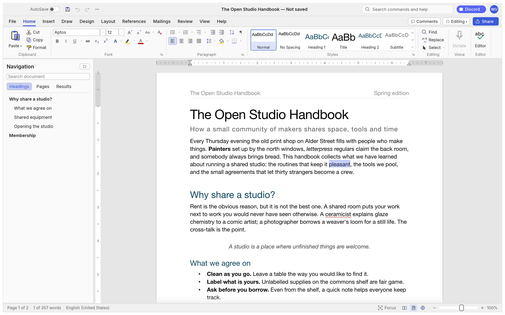
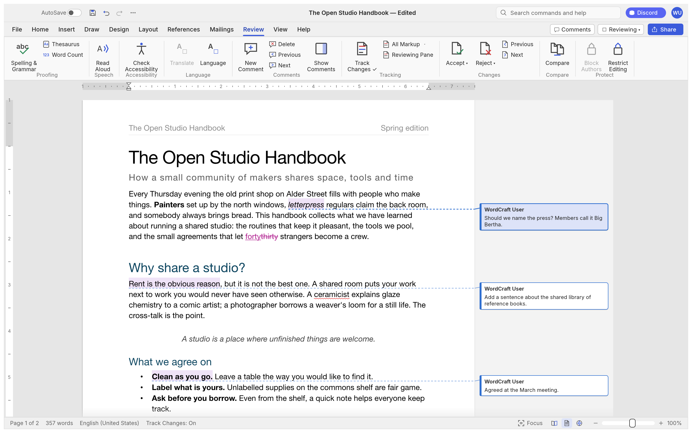
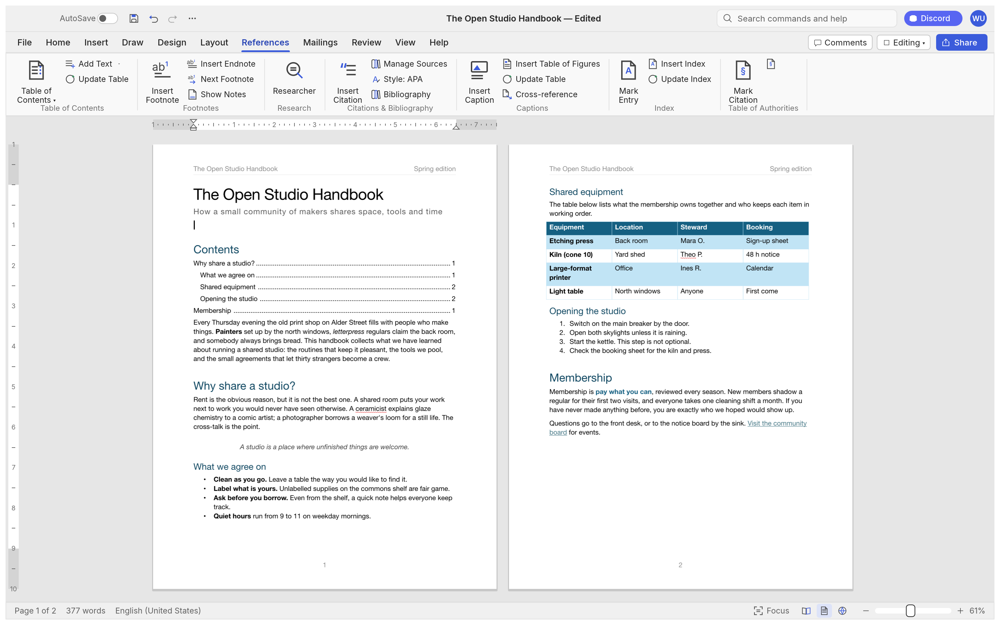
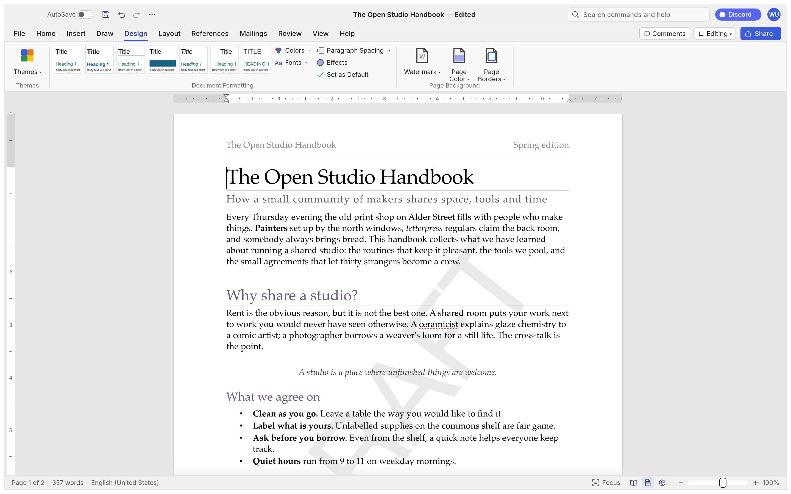
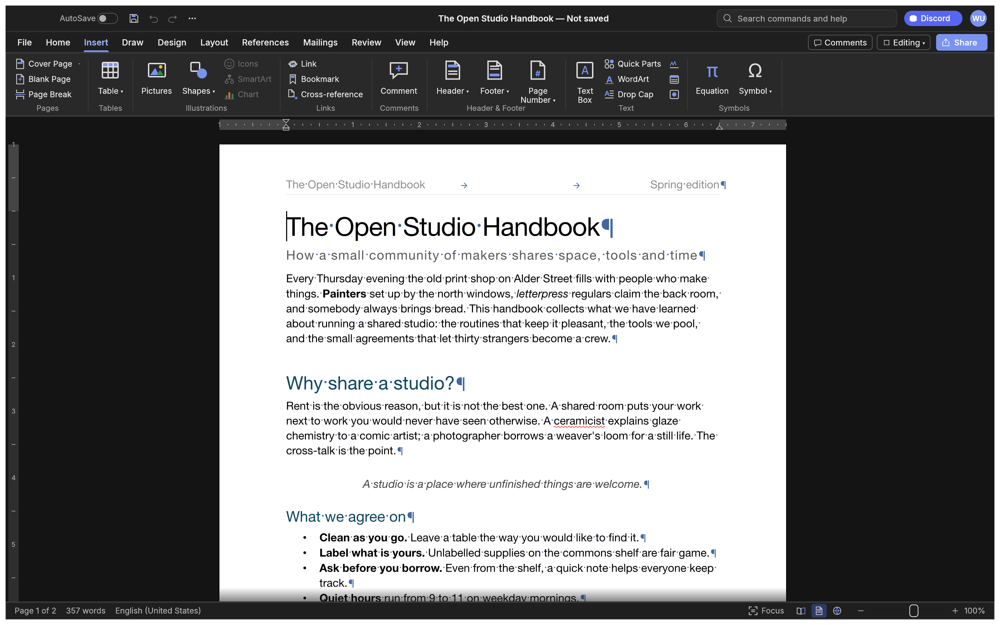
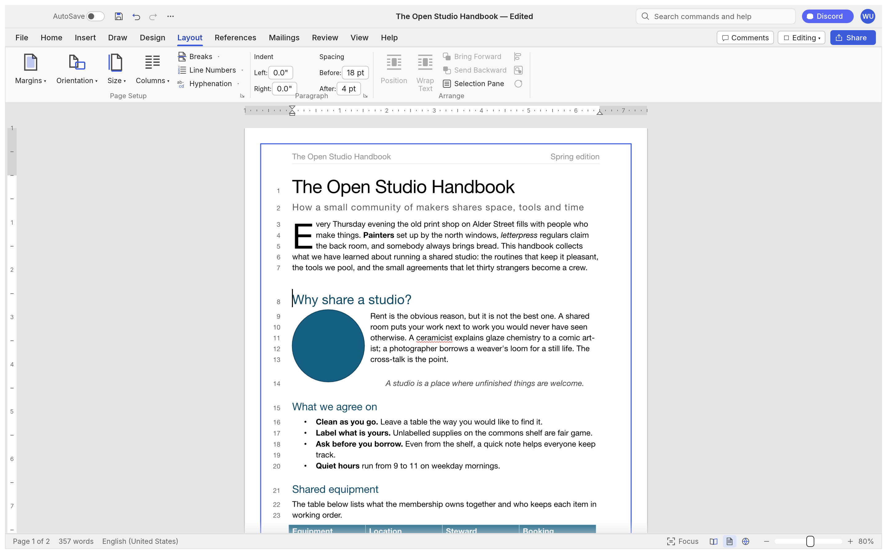
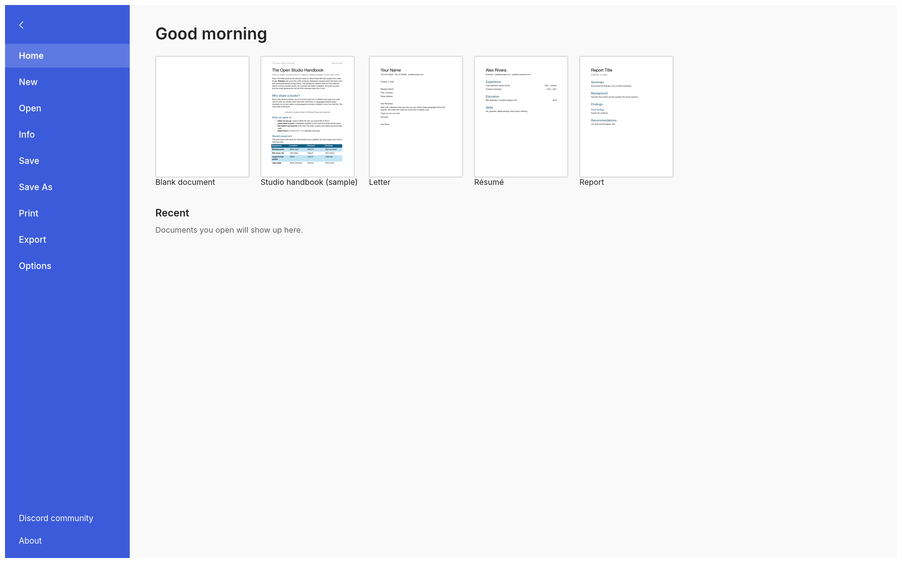

<p align="center">
  <a href="https://github.com/mahmudurrahman420/">
    <picture>
      <source media="(prefers-color-scheme: dark)" srcset="docs/brand/smithsuite-logo-white.svg">
      
    </picture>
  </a>
</p>

<p align="center">
  
</p>

<h1 align="center">Wordsmith</h1>


<p align="center">
  <b>Writing and document design; an open-source, modern word processor, built in pure Rust.</b>
</p>

<p align="center">
  A fast, open-source word processor with a familiar workflow: the ribbon, styles,
  tables, track changes, references and mail merge. It reads and writes .docx, runs natively on
  macOS, Windows, Linux and BSD, and in the browser via WebAssembly.<br>
  <i>By the Smith Suite team.</i>
</p>

<p align="center">
  
  
  
  
  <br>
  <a href="https://sonarcloud.io/project/overview?id=storytold_wordsmith"></a>
  <a href="https://coderabbit.ai"></a>
</p>

<p align="center">
  <a href="https://github.com/mahmudurrahman420/wordsmith/discussions"></a>
</p>

<p align="center">
  <a href="https://github.com/mahmudurrahman420/wordsmith"><b>Wordsmith on github.com/mahmudurrahman420</b></a> ·
  <a href="https://github.com/mahmudurrahman420/">Smith Suite</a> ·
  <a href="https://github.com/mahmudurrahman420/apps">All Crafting Apps</a>
</p>

<br>

<p align="center">
  
  <br><sub><b>The Open Studio Handbook</b>, Wordsmith's built-in sample: the ribbon, live Styles gallery, rulers and the Navigation pane.</sub>
</p>

> [!NOTE]
> **Smith Suite is a community of artists from all walks of life.** Painters, photographers,
> filmmakers, illustrators, designers, animators, hobbyists, and people who picked up a pencil
> last week. If you make things, you're one of us. **[Come say hi on Discord](https://github.com/mahmudurrahman420/wordsmith/discussions).**

<p align="center">
  <a href="#a-tour">A tour</a> ·
  <a href="#why-wordsmith">Why Wordsmith</a> ·
  <a href="#what-works-today">What works today</a> ·
  <a href="#quick-start">Quick start</a> ·
  <a href="#for-agents-cli-and-mcp">For agents</a> ·
  <a href="#architecture">Architecture</a> ·
  <a href="#roadmap">Roadmap</a> ·
  <a href="#downloads">Downloads</a> ·
  <a href="#the-crafting-apps">The Crafting Apps</a> ·
  <a href="#license-and-credits">License and credits</a>
</p>

## A tour

Every screenshot below is Wordsmith itself, rendered offscreen by its own UI test harness
(`cargo run -p wordsmith-ui-egui --example ui_shot`).

<table>
<tr>
<td width="50%" valign="top"><p align="center"><sub><b>Review.</b> Track changes, comment balloons in the margin, accept and reject, spelling and grammar as you type.</sub></p></td>
<td width="50%" valign="top"><p align="center"><sub><b>References.</b> Tables of contents, footnotes, citations in APA, MLA, Chicago or IEEE, index and captions.</sub></p></td>
</tr>
<tr>
<td width="50%" valign="top"><p align="center"><sub><b>Design.</b> Themes, style sets, paragraph spacing, watermarks, page colour and borders.</sub></p></td>
<td width="50%" valign="top"><p align="center"><sub><b>Dark mode</b> with formatting marks, and the Insert tab: tables, pictures, shapes, links, headers, footers, fields and symbols.</sub></p></td>
</tr>
<tr>
<td colspan="2"><p align="center"><sub><b>Layout.</b> Drop caps, text wrapping around pictures and shapes, automatic hyphenation, line numbers and page borders.</sub></p></td>
</tr>
<tr>
<td colspan="2"><p align="center"><sub><b>File.</b> Start from a template, open recent documents, edit properties, export to PDF and other formats.</sub></p></td>
</tr>
</table>

## Why Wordsmith

- **Familiar.** Ribbon tabs, groups, shortcuts and behaviour: Enter continues a list,
  Tab demotes it, Ctrl/⌘+B bolds the word under the caret, the Styles gallery previews styles live,
  F4 repeats, F7 checks spelling, F8 extends the selection.
- **Your files.** Opens and saves .docx (OOXML), and also .odt, .rtf, .html, .md, .tex (LaTeX), .txt; opens legacy 97-2003 .doc; exports PDF
  with real, selectable text, links and bookmarks.
- **Fast.** Paragraph layout is cached, so typing in a 188-page document re-lays it out in about
  1.4 ms; pages render on demand.
- **Everywhere.** One Rust codebase for macOS, Windows, Linux, BSD and the web. No Electron, no
  Tauri: native [egui](https://github.com/emilk/egui) on the GPU.
- **Built for agents.** Every action is a command with an id. The same 422 commands drive the
  ribbon, keyboard shortcuts, the command search, a command-line tool, a JSON control channel and
  an MCP server.
- **Private.** Spelling, grammar and everything else work offline.
- **Open.** MIT OR Apache-2.0. Clean-room: built from public specifications and observation, with
  every asset original or openly licensed.

## What works today

| Area | Highlights |
|---|---|
| **Writing** | Fast typing with IME, smart quotes, AutoCorrect, list autoformat (`* `, `1. `), dashes; word, sentence, paragraph selection; drag-select; clipboard with formatting; undo/redo; find and replace with regex |
| **Formatting** | Fonts, sizes, bold/italic/underline styles, strike, sub/superscript, caps, highlight, colours, character spacing, Format Painter, Change Case, Clear Formatting |
| **Paragraphs** | Alignment, indents (draggable on the ruler), spacing, line spacing, tabs with leaders, borders, shading, keep with next, widow/orphan control |
| **Styles** | Built-in style set, live gallery, Styles pane, create/modify/update styles, style sets, themes |
| **Lists** | Bullets, numbering, multilevel, restart, set value, custom formats |
| **Tables** | Insert by grid, merge/split, styles with banded rows, borders, shading, header rows repeated across pages, rows that split across pages, sort, formulas, text ↔ table |
| **Pages** | Margins, orientation, size, columns, page/column/section breaks, headers and footers (first page, odd/even), page numbers, watermark, page borders, line numbers, vertical alignment, drop caps, automatic hyphenation |
| **Objects** | Pictures (resize, crop, recolour, brightness/contrast, transparency, background removal, picture styles, rotate), shapes, text boxes, floating position with text wrapping (square, top and bottom, behind or in front of text) |
| **References** | Table of contents, footnotes and endnotes, citations and bibliography (APA, MLA, Chicago, IEEE), captions, table of figures, cross-references, index, table of authorities |
| **Review** | Spelling and grammar with suggestions (English and Polish, by each run's language), thesaurus, word count, comments in margin balloons or a pane, track changes, accept/reject, compare documents, restrict editing, accessibility checker, document inspector |
| **Mailings** | Mail merge from CSV, merge fields, address block, greeting line, rules, preview, finish to a document; envelopes and labels |
| **View** | Print layout, web layout, draft, read mode, focus, zoom, one/multiple pages, page width, Navigation pane, rulers, gridlines, dark mode; interface in English, 简体中文, 繁體中文, 日本語, Português (Brasil), Español, Українська, Српски / Srpski, Eesti, Türkçe, Русский, Italiano, Deutsch, Polski, Čeština, Magyar, Français, Български, Tiếng Việt, 한국어, Svenska, Hrvatski, Nederlands, Dansk, Română, العربية (mirrored) or Slovenščina (follows the system language by default) |
| **Files** | .docx read/write, legacy 97-2003 .doc import, PDF export, .odt, .rtf, .html, .md, .tex, .txt import/export, page images |

The honest picture, area by area, is in [ROADMAP.md](ROADMAP.md), the
[parity assessment](docs/target-app-parity.md) and the generated
[feature checklist](docs/parity-checklist.md).

## Quick start

```sh
git clone https://github.com/mahmudurrahman420/wordsmith
cd wordsmith
cargo run --release -p wordsmith -- --sample        # the desktop app with the sample document
cargo run --release -p wordsmith -- report.docx     # open a document
```

The interface translations and the spelling and hyphenation data come from
[craft-i18n](https://github.com/storytold/craft-i18n), an optional build input. To build with them,
check it out at the commit in `craft-i18n.rev` and point `CRAFT_I18N_DIR` at it (an absolute
path); without it Wordsmith builds with an English interface, English spelling falls back to an
installed Hunspell English or craft-proof's built-in word list, and only Bulgarian, Turkish and
Russian hyphenate (by rule):

```sh
git clone https://github.com/storytold/craft-i18n ../craft-i18n
git -C ../craft-i18n checkout "$(cat craft-i18n.rev)"
CRAFT_I18N_DIR="$PWD/../craft-i18n" cargo run --release -p wordsmith -- --sample
```

Command line:

```sh
wordsmith-cli convert report.docx report.pdf        # docx, pdf, odt, rtf, html, md, tex, txt, png
wordsmith-cli text report.docx                      # plain text
wordsmith-cli inspect report.docx                   # structure as JSON
wordsmith-cli run --template sample \
  --cmd 'select.text={"text":"Membership"}' --cmd format.bold --save out.docx
wordsmith-cli run --script job.json                 # the same from a file: commands, then save to docx and pdf
```

Web: `cd apps/wordsmith-web && trunk serve`, then open <http://127.0.0.1:8771/?sample>.

## For agents: CLI and MCP

Wordsmith was designed to be driven by people *and* by AI agents.

```sh
claude mcp add wordsmith -- wordsmith-cli mcp                  # headless documents
# confine the agent to folders: wordsmith-cli mcp --automation-read-root DIR --automation-write-root DIR
wordsmith --control 7981 &                                     # or drive the running app…
claude mcp add wordsmith-app -- wordsmith-cli mcp --connect 127.0.0.1:7981
```

Tools include `list_commands`, `execute`, `batch`, `type_text`, `select_text`, `inspect_document`,
`render_page`, `save_document`, and, with a running app, `screenshot`, `click` and `key`. Agents
can check their work through `inspect_document` without screenshots. See [docs/mcp.md](docs/mcp.md)
and the [control protocol](docs/control-protocol.md). Macros record any sequence of commands and
play it back (`tools.recordMacro`, `tools.macros`).

## Logs

The desktop app writes its log records to standard error and to `logs/wordsmith.log` next to its
preferences: on Linux `$XDG_CONFIG_HOME/wordsmith/logs/` (by default `~/.config/wordsmith/logs/`),
on macOS `~/Library/Application Support/Wordsmith/logs/`, on Windows `%APPDATA%\Wordsmith\logs\`.
A start from a desktop menu or the Dock has no terminal, so this file is what to attach to a bug
report: unreadable parts of a .docx, pictures or fonts a PDF export had to leave out and panics the
command guard recovered from land there. Each launch moves the previous log to `wordsmith.1.log`
(and that one to `wordsmith.2.log`), so the log of a run that crashed survives the next start; a
log stops growing at 16 MiB. `--version` writes no file, and runs with `WORDSMITH_NO_PREFS` (agents'
test runs) log to standard error only. Document text is never logged; a panic message leaves out
the text it quotes.

By default Wordsmith's own crates log at `info` and everything else at `warn`. `RUST_LOG` replaces
that with env_logger-style directives, for example `RUST_LOG=debug`,
`RUST_LOG=warn,wordsmith_docx=trace` or `RUST_LOG=info,wgpu_core=warn`; a directive ending in `*`
covers every target starting with it (`wordsmith*=debug`). The logger is
`apps/wordsmith/src/logging.rs`.

## Architecture

| Layer | Crate | Job |
|---|---|---|
| L0 | `wordsmith-geom` | units and measurements |
| L1 | `wordsmith-doc`, `wordsmith-fonts`, `wordsmith-proof` ([`craft-proof`](https://github.com/storytold/craft-libs/tree/main/crates/proof) from craft-libs) | document model and editing; fonts and shaping; spelling, grammar, hyphenation (data: craft-i18n `language-data/`, `CRAFT_I18N_DIR`) |
| L2 | `wordsmith-layout`, `wordsmith-docx`, `wordsmith-formats` | line breaking, pagination, tables, notes, hit testing; OOXML; ODT/RTF/HTML/Markdown/TXT |
| L3 | `wordsmith-render`, `wordsmith-pdf` | rasteriser (vello_cpu); PDF ([craft-pdf](docs/shared-pdf.md), Krilla) |
| L4 | `wordsmith-engine` | session, undo, 422 commands, document feature catalog |
| L5 | `wordsmith-mcp` | MCP server |
| L6 | `wordsmith-ui-egui` | the word processor front end (swappable) |
| apps | `wordsmith`, `wordsmith-cli`, `wordsmith-web` | desktop, command line, browser |

`cargo xtask ci` runs formatting, clippy, ~800 tests, the asset-attribution check, the layering
check and the wasm build. Contributor and agent instructions: [AGENTS.md](AGENTS.md).

## Roadmap

Wordsmith is in **alpha**. It has commands for 97% of the ribbon and menu features in its feature catalog
([`docs/parity-checklist.md`](docs/parity-checklist.md)) today; counting
depth, file fidelity, stability and the rest, we estimate it is about 60% ready for real work,
about 55% for a typical professional's weekly work and about 63% for everyday essentials. Beta
needs testing against real-world .docx files, keeping charts and SmartArt through a round trip,
closer pagination fidelity, a stability sweep and native printing. Details and estimates:
[ROADMAP.md](ROADMAP.md) and [where we fall short](docs/gaps.md).

## Downloads

**Download Wordsmith** from GitHub: the [latest release](https://github.com/mahmudurrahman420/wordsmith/releases/latest) has every build listed below, and [all releases](https://github.com/mahmudurrahman420/wordsmith/releases) has earlier versions and their notes. `<ver>` in the file names is the version number, and `SHA256SUMS.txt` lists a checksum for every file.

### Windows

| Build | Installer | Portable |
|---|---|---|
| x64 (64-bit Intel/AMD) | `wordsmith-<ver>-windows-x64.msi` | `wordsmith-<ver>-windows-x64-portable.zip` |
| arm64 (Snapdragon and other ARM PCs) | `wordsmith-<ver>-windows-arm64.msi` | `wordsmith-<ver>-windows-arm64-portable.zip` |
| x86 (32-bit) | `wordsmith-<ver>-windows-x86.msi` | `wordsmith-<ver>-windows-x86-portable.zip` |

The installer is one dual-scope package. By default it installs for your account only,
into `%LOCALAPPDATA%\Programs\Smith Suite\Wordsmith`, and needs no administrator rights; choosing
"Everyone on this computer" on the first page installs into `C:\Program Files\Smith Suite\Wordsmith` (`Program Files (x86)` for the 32-bit build)
and asks for an administrator. Install only one copy: a copy for another scope is refused, so
uninstall first to change who Wordsmith is installed for. Installers and executables are code-signed.

**If the app doesn't open on Windows:** the desktop app initializes only DirectX 12 by default.
Letting wgpu also create an OpenGL instance can crash some graphics drivers (AMD's
`atio6axx.dll`) before the window appears, so the app would flash in Task Manager and quit.
`WGPU_BACKEND` overrides the default for troubleshooting (for example `dx12` or `vulkan`). In
PowerShell, from the folder containing the executable:

```powershell
$env:WGPU_BACKEND = "vulkan"
& .\wordsmith.exe
Remove-Item Env:WGPU_BACKEND                     # restore the default for later launches
```

An explicit `gl` override can bring the driver crash back on affected systems. The macOS, Linux
and web backend defaults are unchanged.

The **32-bit** build uses OpenGL even when a DirectX 12 graphics card is present. On 32-bit
Windows, creating a DirectX 12 graphics pipeline fails immediately and the app exits before the
window appears. `WGPU_BACKEND=vulkan` (or `dx12`) still overrides that.

**If the app quits right after its window appears with "Parent device is lost" in the log:**
Wordsmith compiles DirectX 12 shaders with FXC, the compiler built into Windows, so it needs no
`dxcompiler.dll`/`dxil.dll` and ignores any copy another program put on `PATH` (#603).
`WGPU_DX12_COMPILER` (`fxc`, `dxc`, `auto`) overrides this; with `dxc`, a matching
`dxcompiler.dll` *and* `dxil.dll` must sit next to `wordsmith.exe`. `WGPU_BACKEND = "vulkan"`
also avoids DirectX 12 altogether.

**If the app is slow on an older Windows PC:** when DirectX 12 finds no graphics card with a
driver for it (for example Intel 4th-generation graphics on Windows 11), it only offers the built-in
software renderer, which draws every frame on the processor. Wordsmith normally uses OpenGL instead,
without setting anything. If OpenGL has no usable adapter, it can use DirectX 12's WARP software
adapter. The log file records the choice (lines starting with
`graphics:`). `WGPU_BACKEND` still overrides it, e.g. `$env:WGPU_BACKEND = "gl"` or `"dx12"`.

### macOS

| Build | File | Notes |
|---|---|---|
| App, universal (Apple silicon + Intel) | `wordsmith-<ver>-macos-universal.dmg` | Signed and notarized |
| Command-line tool, universal | `wordsmith-cli-<ver>-macos-universal.zip` | Signed and notarized |

### Linux

| Format | x86_64 | aarch64 (ARM64) | Notes |
|---|---|---|---|
| AppImage | `wordsmith-<ver>-linux-x86_64.AppImage` | `wordsmith-<ver>-linux-aarch64.AppImage` | Runs anywhere; updates itself with [AppImageUpdate](https://github.com/AppImageCommunity/AppImageUpdate) (`.zsync` files) |
| Flatpak | `wordsmith-<ver>-linux-x86_64.flatpak` | `wordsmith-<ver>-linux-aarch64.flatpak` | Sandboxed; `flatpak install --user <file>` |
| Debian/Ubuntu | `wordsmith-<ver>-linux-x86_64.deb` | `wordsmith-<ver>-linux-aarch64.deb` | |
| Fedora/RHEL/openSUSE | `wordsmith-<ver>-linux-x86_64.rpm` | `wordsmith-<ver>-linux-aarch64.rpm` | |
| Tarball | `wordsmith-<ver>-linux-x86_64.tar.gz` | `wordsmith-<ver>-linux-aarch64.tar.gz` | Unpack anywhere |

RISC-V (riscv64): `wordsmith-<ver>-linux-riscv64.tar.gz`, a tarball cross-compiled for glibc 2.39+
(Ubuntu 24.04, Debian 13 and newer).

**Wayland:** on a Wayland desktop the app runs through XWayland when it is available, because
winit (the windowing library) supports dragging files into the window only on X11. To use the
native Wayland backend instead (for example for sharper text with fractional scaling, at the cost
of file drag-and-drop), start it with `WORDSMITH_WAYLAND=1`:

```sh
WORDSMITH_WAYLAND=1 wordsmith
```

**Arch Linux (AUR).** Community members maintain three AUR packages; the project doesn't publish
to the AUR itself. Install one of them:
| Package | What it installs | Choose it when |
|---|---|---|
| [`wordsmith-bin`](https://aur.archlinux.org/packages/wordsmith-bin) | The release tarball above, prebuilt (x86_64, aarch64) | You want the latest release without compiling (quickest) |
| [`wordsmith`](https://aur.archlinux.org/packages/wordsmith) | The latest release, built from source with `cargo` | You prefer to build releases yourself |
| [`wordsmith-git`](https://aur.archlinux.org/packages/wordsmith-git) | The current `main` branch, built from source | You want unreleased changes and accept an occasional broken build |
For example `yay -S wordsmith-bin` or `paru -S wordsmith-bin`.

#### Community packages

These packages are maintained by community members, not by the Wordsmith team.

On Gentoo, the [::snakebyte overlay](https://github.com/switch87/snakebyte-overlay) packages the
Linux release as `app-office/wordsmith-bin` (prebuilt) and `app-office/wordsmith` (built from source):

```sh
eselect repository add snakebyte git https://github.com/switch87/snakebyte-overlay.git
emaint sync -r snakebyte
echo 'app-office/wordsmith-bin ~amd64' >> /etc/portage/package.accept_keywords/wordsmith
emerge --ask app-office/wordsmith-bin
```

### FreeBSD

| Build | File |
|---|---|
| x86_64 | `wordsmith-<ver>-freebsd-x86_64.tar.gz` |

### Web (WebAssembly)

| Build | File | Notes |
|---|---|---|
| Static site | `wordsmith-web-<ver>.zip` | Runs in a modern browser; host it on any static server |

## The Crafting Apps

Wordsmith is one of the **Crafting Apps**: free, open-source creative tools from the
[Smith Suite](https://github.com/mahmudurrahman420/) team, each written from scratch in Rust and each able to
stand on its own.

| | App | What it's for | Code | Learn more |
|:-:|---|---|---|---|
|  | **Pixelsmith** | Image editing: layers, masks, type and real PSD files | [GitHub](https://github.com/mahmudurrahman420/pixelsmith) | [Website](https://github.com/mahmudurrahman420/pixelsmith) |
|  | **Pathsmith** | Vector illustration | [GitHub](https://github.com/mahmudurrahman420/pathsmith) | [Website](https://github.com/mahmudurrahman420/pathsmith) |
|  | **Framesmith** | Video editing, color and sound | [GitHub](https://github.com/mahmudurrahman420/framesmith) | [Website](https://github.com/mahmudurrahman420/framesmith) |
|  | **Rawsmith** | Photo library and raw development | [GitHub](https://github.com/mahmudurrahman420/rawsmith) | [Website](https://github.com/mahmudurrahman420/rawsmith) |
|  | **Pagesmith** | Reading, organizing and protecting PDFs | [GitHub](https://github.com/mahmudurrahman420/pagesmith) | [Website](https://github.com/mahmudurrahman420/pagesmith) |
|  | **Motionsmith** | Motion graphics and visual effects | [GitHub](https://github.com/mahmudurrahman420/motionsmith) | [Website](https://github.com/mahmudurrahman420/motionsmith) |
|  | **Layoutsmith** | Page layout and publishing | [GitHub](https://github.com/mahmudurrahman420/layoutsmith) | [Website](https://github.com/mahmudurrahman420/layoutsmith) |
|  | **Mocksmith** | Interface design and prototyping | [GitHub](https://github.com/mahmudurrahman420/mocksmith) | [Website](https://github.com/mahmudurrahman420/mocksmith) |
|  | **Wordsmith** | Word processing and documents | [GitHub](https://github.com/mahmudurrahman420/wordsmith) | [Website](https://github.com/mahmudurrahman420/wordsmith) |
|  | **Soundsmith** | Audio recording and editing | [GitHub](https://github.com/mahmudurrahman420/soundsmith) | [Website](https://github.com/mahmudurrahman420/soundsmith) |
|  | **Slidesmith** | Presentations and slide decks | [GitHub](https://github.com/mahmudurrahman420/slidesmith) | [Website](https://github.com/mahmudurrahman420/slidesmith) |
|  | **CADsmith** | Computer-aided design | [GitHub](https://github.com/mahmudurrahman420/cadsmith) | [Website](https://github.com/mahmudurrahman420/cadsmith) |
|  | **Cellsmith** | Spreadsheets and data | [GitHub](https://github.com/mahmudurrahman420/cellsmith) | [Website](https://github.com/mahmudurrahman420/cellsmith) |
|  | **Texsmith** | 3D texture painting | [GitHub](https://github.com/mahmudurrahman420/texsmith) | [Website](https://github.com/mahmudurrahman420/texsmith) |
|  | **Anysmith** | See how any software works, then build your own | [GitHub](https://github.com/mahmudurrahman420/anysmith) | [Website](https://github.com/mahmudurrahman420/anysmith) |
|  | **Solidsmith** | Parametric 3D CAD by Tangency Labs (community app) | [GitHub](https://github.com/mahmudurrahman420/solidsmith) | |

And [**Smith Suite**](https://github.com/mahmudurrahman420/) itself, our AI image and video studio for artists who want real control.

<br>

<p align="center">
  <a href="https://github.com/mahmudurrahman420/wordsmith/discussions"></a>
</p>

<h3 align="center">Come make things with us</h3>

<p align="center">
  Our Discord is where artists of every kind hang out: people who paint, shoot, draw, cut film,
  set type, and people still figuring out what they like to make. Share what you're working on,
  ask for help, tell us what's broken, or tell us what you wish these tools could do.
  Whatever your medium and however long you've been at it, you're welcome here.
</p>

<p align="center">
  <a href="https://github.com/mahmudurrahman420/wordsmith/discussions"><b>https://github.com/mahmudurrahman420/wordsmith/discussions</b></a> ·
  <a href="https://github.com/mahmudurrahman420/">github.com/mahmudurrahman420</a> ·
  <a href="https://github.com/mahmudurrahman420/apps">The Crafting Apps</a> ·
  <a href="https://github.com/mahmudurrahman420/wordsmith">Wordsmith</a>
</p>

## License and credits

Wordsmith is dual-licensed under [MIT](LICENSE-MIT) or [Apache-2.0](LICENSE-APACHE), at your option.
Copyright (c) 2026 Shohan (mahmudurrahman420) and the Wordsmith contributors. Required notices are in [NOTICE](NOTICE).

Bundled fonts, icons, images and other assets keep their own open licenses; each one is listed
with its author, source and license in [ATTRIBUTION.md](ATTRIBUTION.md).

The English spelling dictionary and hyphenation come from Grady Ward's public-domain Moby
Hyphenator II word list. Polish spelling reads the Hunspell `pl_PL` dictionary installed on the system (not bundled), as
do Russian, Portuguese, Czech, Italian, Croatian and Turkish spelling (how to install them:
[docs/spelling-dictionaries.md](docs/spelling-dictionaries.md)), and
Polish hyphenation the TeX patterns by Hanna Kołodziejska, Bogusław Jackowski and Marek Ryćko (MIT
option). The sample documents and templates are original text written for Wordsmith.

The Smith Suite name, wordmark and anvil mark in `docs/brand/` are original work by Shohan (mahmudurrahman420), licensed under the project licence (MIT OR Apache-2.0).

<p align="center">
  <a href="https://github.com/mahmudurrahman420/"></a><br>
  <sub>Made by the <a href="https://github.com/mahmudurrahman420/">Smith Suite</a> team and community.</sub>
</p>
